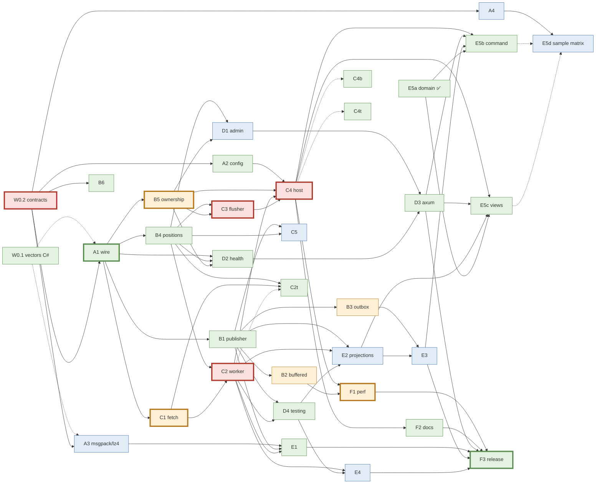

# Plan: RedisEvents for Rust (`bklooste/RedisEvents-rs`)

Status: draft, 2026-10-25. Source of truth for the port is this repo at `f34c43a`.

## 1. Goal

Ship a Rust implementation of RedisEvents that is **wire-compatible** with the C# library, so any of
these work against one Redis:

| Producer | Consumer | Notes |
| --- | --- | --- |
| C# | Rust | Rust consumer reads `s:{topic}:<p>`, stores positions in `p:{topic}:<consumer>` |
| Rust | C# | Rust publisher writes entries the C# `EntryCodec` decodes unchanged |
| C# + Rust | C# + Rust | Mixed publishers on one topic; same partition for the same key |
| — | C# **and** Rust under one `Consumer` name | Lease-mode ownership shared through `o:{topic}:<consumer>` (nice-to-have, tested but not a gate) |
| C# outbox / event sourcing | Rust projection | and the reverse |

"Compatible" means: same keys, same entry fields, same partition for a given key, same position and
lease encoding, and same admin markers. It does **not** mean the same internal design. Rust uses Rust
idioms wherever the bytes in Redis stay identical.

## 2. The wire contract (what has to match byte for byte)

Taken from the code. Phase 0 turns this list into `WIRE.md` plus golden vectors.

### 2.1 Key namespace (`Config/KeyNamespace.cs`)
- Prefix = `STREAMS_KEY_PREFIX` if set. Otherwise `"{env}:re:"`, where `env` is the lowercased
  `ASPNETCORE_ENVIRONMENT`, then `DOTNET_ENVIRONMENT`, defaulting to `production`.
- **Rust must read the same variables in the same order.** A Rust service that defaults to a
  different prefix silently sees an empty topic. Rust may also accept `STREAMS_ENVIRONMENT` as an
  alias, but it must rank below the two .NET variables.

### 2.2 Keys (`Wire/StreamKeys.cs`, `Outbox.StateKey`, `Idempotency`, `RedisViewStore`)
| Key | Shape |
| --- | --- |
| Partition stream | `<prefix>s:{topic}:<p>` (`s:topic:<p>` when co-location is off) |
| Positions | `<prefix>p:{topic}:<consumer>` |
| Positions meta | `<prefix>p:{topic}:<consumer>:meta` |
| Ownership / leases | `<prefix>o:{topic}:<consumer>` |
| Topic meta | `<prefix>m:{topic}` |
| State stream (outbox / ES) | `<prefix>{topic}:state:<name>` (ES name = `es:<Aggregate>:<id>`) |
| View store | `<prefix>{topic}:view:<owner>:<viewName>` |
| Dedupe claim | `<prefix>dedupe:{scope}:<id>` (scope must not contain braces) |

### 2.3 Entry fields (`Wire/EntryCodec.cs`, codec v1)
- `b` body (raw bytes, always present), `t` type (always), `k` partition key (always on a topic entry,
  may be empty, never on a state entry), `c` correlation id, `p` W3C traceparent, `h` packed headers.
- Optional fields are **omitted**, not written empty. Unknown fields are **ignored** on read.
- The codec version is stored once in `m:{topic}` field `v` (= `1`). A reader must refuse any
  other version.
- Enqueue time comes from the stream id's milliseconds. The entry has no timestamp field.

### 2.4 Header block (`Wire/HeaderBlock.cs`)
- `len(key) ':' key len(val) ':' val …`. Lengths are ASCII decimal **UTF-8 byte** counts.
- Caps: 64 headers and 8 KiB packed. The publisher errors when a cap is exceeded and never
  truncates. The reader errors on malformed input.

### 2.5 Partition routing (`Wire/PartitionRouter.cs`)
- Non-empty key: `xxh3_64(utf8(key), seed = 0)`. Fold to a partition with `hash & (n-1)` when `n`
  is a power of two, else `hash % n`. `n <= 1` gives partition 0.
- Rust: `xxhash_rust::xxh3::xxh3_64`. It matches `System.IO.Hashing.XxHash3.HashToUInt64` with the
  default seed. Golden vectors must cover ASCII, multi-byte UTF-8 and long keys.
- Empty key round-robins. The two sides need not agree here, because round-robin makes no ordering
  promise.

### 2.6 Topic meta (`Admin/StreamAdmin.cs`)
- `m:{topic}` holds `partitions`, `v`, `createdUtc` (ISO-8601 round-trip, `"O"`) and `maxLen`, each
  written with `HSETNX`.
- Partitions may grow (log a warning and overwrite) but never shrink (refuse at startup). Rust must
  enforce the same rule, because a C# and a Rust service disagreeing on `partitions` breaks key
  ordering.

### 2.7 Positions (`Positions/RedisPositionStore.cs`, `Admin/StreamAdmin.Reset.cs`)
- One field per partition. The value is `<streamId>|<instanceId>`, with the instance id as a GUID in
  `"D"` form. A value with no `|` is read as a bare id.
- Meta hash fields: `<p>:updatedUtc` (ISO-8601 `"O"`) and `<p>:instanceId`.
- The admin identity GUID `6f72616e-6765-4164-6d69-6e5265736574` marks an operator rewind. The
  flusher must treat it as "rewind", not as "a rival owns this partition".
- Reset marker: field `__reset:<p>`, value `<target id>|<issued time>`. A running worker applies it
  on its next flush and deletes it only after a read loop has taken it. On cold start, pending
  markers are applied before reading. Non-numeric fields are skipped when positions are read.

### 2.8 Ownership (`Ownership/OwnershipRegistry.cs`)
- Hash fields: `"<p>"` holds the owner value `<instanceId>|<POD_NAME>`, and `i:<instanceId>` is a
  presence field carrying the same value. Both carry a per-field TTL set with `HEXPIRE`, so
  **Redis 7.4 or later is required**.
- Lease mode runs the `LeaseScript` and `ReleaseScript` Lua. **Rust embeds both scripts byte for
  byte**, extracted into `wire-spec/lua/` so the two repos share one text. A mixed C#/Rust group
  then claims fair shares correctly, because the script alone decides who owns what.
- Static mode uses `STREAMS_INSTANCE_INDEX` / `STREAMS_INSTANCE_COUNT` or a StatefulSet ordinal, the
  same as C#.

### 2.9 Work-queue delivery
- `Delivery = WorkQueue` runs `XREADGROUP` with group name = consumer. Port the group creation, the
  claim/redelivery rules and the ack semantics from `Consumer/WorkQueueFetch.cs`.

### 2.10 Atomic writes (outbox, event sourcing)
- Outbox: state commands, then `XADD`, in one `MULTI`/`EXEC`.
- ES: optimistic concurrency checks the state stream's `XLEN` (the C# side uses WATCH via
  `Condition.StreamLengthEqual`), then runs `XADD` on the state stream and on the topic in one
  transaction. Rust may implement this as WATCH/MULTI or as one Lua script. Either is fine, because
  the data left in Redis is identical; only the observable result has to match.

### 2.11 Payloads (above the wire, but where interop actually breaks)
- **Type string.** The C# typed API defaults `t` to `typeof(T).FullName`, for example
  `MyCo.Orders.OrderPlaced`. Rust cannot derive that. Rule: **every cross-language message has an
  explicit, stable type string.** Rust's `trait Message { const TYPE: &'static str; }` makes it
  mandatory, and the README tells C# users to pass `type:` or use `EventTypeRegistry` names.
- **JSON casing.** By default System.Text.Json writes PascalCase and serde writes field names as
  written (snake_case). Match the C# side, which is PascalCase unless it sets a naming policy:
  `#[serde(rename_all = "PascalCase")]`, as in `samples/inventory`. Test it with vectors.
  **A mismatch is silent in C#:** System.Text.Json reads `{"id":…,"count":7}` into a
  PascalCase type as an empty GUID and `0`, with no error. serde rejects the reverse mismatch with
  a missing-field error.
- **MessagePack.** MessagePack-CSharp writes `[Key(int)]` types as arrays and `[Key("x")]` types as
  maps. `rmp-serde` defaults to arrays (matching `Key(int)`) and needs `with_struct_map()` for the
  map form. LZ4 uses MessagePack-CSharp's **`Lz4BlockArray`** framing: an array whose first element
  is ext type **98** holding the uncompressed lengths, followed by `bin` LZ4 *block* chunks. No Rust
  crate implements this, so we write it with `lz4_flex::block`. Decode `Lz4Block` (ext 99) as well.
  The size gate defaults to 1024 bytes.

## 3. Repository & crates

New public repo **`bklooste/RedisEvents-rs`** (MIT), a Cargo workspace. The crate name
`redis-events` is taken on crates.io; the `redisevents` family is free (checked 2026-10-25).

```
RedisEvents-rs/
  wire-spec/
    WIRE.md                    language-neutral spec of §2, versioned with the codec (v1)
    vectors/*.json             golden vectors: entries, header blocks, routing, keys, positions, msgpack/LZ4
    lua/lease.lua release.lua  the ownership scripts, shared text
  crates/
    redisevents/               core  ← RedisEvents (wire, producer, consumer, positions, ownership, outbox, admin, trimming, diagnostics)
    redisevents-msgpack/       ← RedisEvents.MessagePack
    redisevents-projections/   ← RedisEvents.Projections
    redisevents-eventsourcing/ ← RedisEvents.EventSourcing (depends on projections, same as C#)
    redisevents-restate/       ← RedisEvents.Restate
    redisevents-axum/          ← RedisEvents.Web + HealthChecks (admin routes + health), axum feature-gated
  interop/
    dotnet/InteropHost/        small C# console app on the *published* RedisEvents NuGet: produce / consume / admin verbs
    rust-host/                 the same verbs in Rust
    scenarios/                 scripted scenarios run by the CI interop job
  samples/inventory/           CQRS-ES sample, a port of cqrs-simple-micro-service/redis: domain, command (write), views (read)
  benches/                     criterion benches mirroring StreamsMicroBenchmarks
```

`RedisEvents.Tracing` becomes an `otel` cargo feature on the core crate. Rust has no DI container to
hook into, so a separate crate adds nothing.

### Stack
| Concern | Choice | Why |
| --- | --- | --- |
| Runtime | `tokio` + `tokio-util::CancellationToken` | standard; maps to `BackgroundService` / `CancellationToken` |
| Redis client | `redis` (redis-rs) with `tokio-comp`, `connection-manager`, `cluster-async` | `MultiplexedConnection` matches the SE.Redis multiplexer model; pipelines, `Script`, raw `cmd("HEXPIRE")` |
| Hash | `xxhash-rust` (`xxh3`) | bit-identical to `XxHash3` |
| Serialization | `serde`, `serde_json`, `rmp-serde`, `lz4_flex` | |
| Ids | `uuid` (v4, hyphenated = .NET `"D"`) | |
| Time | `time` or `chrono`, RFC 3339 with 7 fractional digits to match .NET `"O"` | |
| Observability | `tracing`, `opentelemetry` (metrics names identical: `streams.errors`, `streams.blocked`, `streams.clamp.released`, `streams.partitions.unowned`, `streams.batch.duration`) | dashboards work for both |
| Config | `serde` structs + the `config` crate, using the same section and key names as `StreamConfigBinder` | one config file per environment serves both |
| HTTP | `axum` (admin), `reqwest` (Restate ingress) | |
| Tests | `testcontainers` (`redis:8-alpine`), `proptest`, `criterion` | |

### API shape (C# → Rust)
| C# | Rust |
| --- | --- |
| `builder.AddStream<H>("orders")` | `Streams::builder(redis).topic("orders").handler(h).spawn()` returns a `StreamsHost` handle |
| `IMessageHandler` / `IBatchHandler` | `trait MessageHandler` / `trait BatchHandler` (native `async fn` in traits) |
| `IMessageHandler<T>` + `JsonTypeInfo<T>` | `TypedHandler<T: Message + DeserializeOwned>` with a codec type parameter (JSON / MessagePack) |
| Error contract: ordinary exception = skip, `DontIgnoreException` = block | `Result<(), HandleError>`, where `HandleError::Skip(e)` logs and skips and `HandleError::Block(e)` blocks and retries (1s→2→4→8→16→30s). A panic counts as `Skip`, mirroring "ordinary exception". |
| `IStreamPublisher`, `IStreamBufferedPublisher` | `Publisher`, `BufferedPublisher` (bounded mpsc channel + flush task; same loss-on-crash trade-off, documented) |
| `Outbox.WriteAndPublishAsync` | `Outbox::write_and_publish(\|pipe\| { ... })` taking a `redis::Pipeline` in atomic mode |
| `StreamAdmin` | `StreamAdmin` with the same operations (preview/reset, ownership, topic tail) |
| `Testing/*` | `redisevents::testing` (in-memory publisher, harness) behind a `testing` feature |

## 4. Phases

Each phase ends with green CI. §8 splits the phases into work packages for parallel agents. From Phase 2 on, each phase also passes its rows of the interop
matrix in §5.

### Phase 0: Contract first (both repos)
1. Create `bklooste/RedisEvents-rs` (`gh repo create bklooste/RedisEvents-rs --public --license mit`),
   with the workspace skeleton, `rust-toolchain.toml` (stable), `rustfmt`/`clippy -D warnings`, and
   CI (build, test, clippy, a `redis:8-alpine` service).
2. Write `wire-spec/WIRE.md` from §2.
3. **In this repo:** add a small vector generator test that writes `vectors/*.json` from the real C#
   `EntryCodec`, `HeaderBlock`, `PartitionRouter`, `StreamKeys` and MessagePack paths. Add a
   conformance test that reads them back. Extract the two Lua scripts to embedded resource files so
   they can be copied verbatim. This is one PR here; the C# library's behaviour stays unchanged.
4. Copy the vectors and Lua scripts into the Rust repo. A CI check diffs them against the C# repo at
   a pinned tag, so drift fails the build.

Exit: the spec is reviewed, the vectors exist, and C# passes its own vectors.

### Phase 1: Core wire layer (pure, no Redis)
`StreamId`, `EntryCodec` (encode/decode, state variant), `HeaderBlock` (zero-copy reader over
`bytes::Bytes`), `PartitionRouter`, `StreamKeys`, `KeyNamespace`, `StreamMsg`.

Exit: every golden vector passes, and proptest round-trips headers and ids.

### Phase 2: Producer
Topic meta init/grow/refuse-shrink, direct `XADD`, pipelined batch publish, buffered publisher,
`MAXLEN ~` trimming plus the background trimmer (respecting the position interlock), the outbox,
idempotency (`SET NX PX`), and the topic forwarder.

Exit: **Rust → C#** interop scenarios pass (single, batch, buffered, headers, trace, outbox).

### Phase 3: Consumer
Partition workers (block fetch and poll fetch), batch dispatch, the error contract with backoff,
the position store and flusher (`<id>|<instance>` values, meta hash, foreign-writer cross-check),
reset markers, Lease ownership (shared Lua) and Static mode, the work-queue mode, backpressure,
start positions / replay-from-time, and graceful shutdown (flush positions, release leases).

Exit: **C# → Rust** interop passes.

Nice-to-have, not a gate: a C# and a Rust instance under the same `Consumer` name in Lease mode
split partitions fairly and fail over. The shared Lua should make this work for free, so it is
tested, but a failure is a bug to fix later, not a blocker. The `XREADGROUP` work-queue mode is
rarely used and is deferred to after Phase 5.

### Phase 4: Operability
Diagnostics (lag, health, status, partition status), OpenTelemetry metrics/spans with identical
names, `StreamAdmin`, the `redisevents-axum` admin routes and health check (same paths as
`RedisEvents.Web`), and the config binder with the same keys.

Exit: an admin reset issued from **C#** rewinds a running **Rust** consumer, and the reverse.

### Phase 5: Opt-in packages
1. `redisevents-msgpack`, including the `Lz4BlockArray` codec. Test cross-decoding both ways, above
   and below the 1024 B gate.
2. `redisevents-projections`: an event type registry with explicit wire names, projectors,
   `ViewStore` trait, Redis and in-memory stores (same view key).
3. `redisevents-eventsourcing`: aggregate root, repository with optimistic concurrency, and a cached
   aggregate with the concurrency-check switch from #47.
4. `redisevents-restate`: filter + map, bounded-parallel starts, block rather than skip.

Exit: the Inventory CQRS-ES sample (`samples/inventory`, a port of
[cqrs-simple-micro-service/redis](https://github.com/bklooste/cqrs-simple-micro-service/tree/main/redis))
passes the C# sample's own HTTP suites in all four write/read pairings, and an aggregate saved from
C# loads in Rust with the same version.

### Phase 6: Performance and release
Criterion benches that mirror `StreamsMicroBenchmarks`, an end-to-end throughput suite that mirrors
`PerfBenchmarkTests`, README with measured numbers, `cargo-semver-checks`, and publishing to
crates.io (optional, needs a token).

## 5. Interop test matrix (CI job `interop`)

The CI job starts `redis:8-alpine`, builds `interop/dotnet/InteropHost` against **(a)** the latest
published NuGet and **(b)** `bklooste/RedisEvents@main`, builds `rust-host`, then runs every scenario
in both directions:

| Scenario | Checks |
| --- | --- |
| Keyed publish, 1/4/7/16 partitions | same key lands on the same partition from both languages; per-key order preserved |
| Headers, correlation id, traceparent | round-trip exactly; trace continues across the language boundary |
| Unicode / empty / long keys | routing and `k` field match |
| Batch + buffered publish | count and order per key |
| Positions resume | stop the C# consumer, start a Rust consumer with the same consumer name; it resumes with no gap or replay beyond the last flush |
| Mixed Lease group (nice-to-have) | fair split, failover within one TTL, no dual ownership |
| Admin reset | marker written by one language, applied by the other |
| Partition grow | either side grows; the other refuses to shrink |
| Codec version guard | `v=2` in `m:{topic}` makes both sides refuse |
| Outbox / ES | state + event atomic; version check honoured across languages |
| JSON + MessagePack (+LZ4) payloads | typed decode both ways using explicit type strings |
| CQRS-ES sample, 4 pairings | C#/Rust write side × C#/Rust read side; the C# Scenarify suites (`SimpleCQRS.API.IntegrationTests`, `SimpleCQRS.Views.IntegrationTests`) run unchanged against each pairing via `SvcHttpUrl` |
| Work queue (deferred) | competing C#/Rust consumers in one `XREADGROUP` group; no message lost |

## 6. Interop hazards to design out

| Hazard | Mitigation |
| --- | --- |
| `t` defaults to C# `FullName` | Rust requires `Message::TYPE`; the C# docs recommend explicit types for cross-language topics |
| JSON property casing (silent in C#: wrong casing reads as defaults) | match C# (PascalCase by default); golden bodies from the real C# types; Rust rejects mismatches |
| MessagePack array vs map | document the mapping; vectors for both forms |
| Different key prefix per runtime | identical env var resolution; startup log prints the resolved prefix |
| GUID / timestamp text formats | `uuid` hyphenated lowercase; timestamps with 7 fractional digits + `Z`/offset, and the parser accepts both |
| `HEXPIRE` availability | same startup probe (`__hexpire-probe:<id>`); refuse Lease mode without it, as C# does |
| Lua drift | one shared script text, plus a CI diff |
| Partition count disagreement | meta check on both sides, and the mixed-grow test |
| Cluster slots | same `{topic}` hash tags; the outbox and ES require co-location, as C# does |

## 7. Versioning rules
- Wire spec version = codec version (`v` in `m:{topic}`), currently 1. Any change to §2 is a spec
  PR with new vectors, landed in **both** repos before either releases.
- Crate versions are independent of NuGet versions. The README holds a compatibility table:
  "redisevents 0.x ↔ RedisEvents NuGet ≥ y, codec v1".
- The Rust repo's CI runs interop against C# `main` nightly, so a C# change that breaks Rust is
  caught before a release.

## 8. Work breakdown: dependencies, complexity and agent allocation

This section splits the phases in §4 into **work packages** (WPs). Each WP is sized so that one
agent can take it in its own worktree and finish with one PR. The goal is to show where agents can
run in parallel and where the work is serial.

### 8.1 Two axes: complexity picks the agent, size picks the schedule

- **Complexity (Cx 1–5)** is how much judgment the work needs. It decides the model. A Haiku agent
  can port a large WP when the work is mechanical and tests or golden vectors pin down the answer.
  A small WP with a race in it needs Opus.
- **Size (S/M/L/XL)** is volume: how many C# lines and tests have to be read and ported. It
  decides wall-clock time and token cost, and so the critical path and the waves. It does **not**
  decide the model.

| Cx | Meaning | Typical drivers | Agent |
| --- | --- | --- | --- |
| **1** | Mechanical | transliteration; tests or vectors decide every answer; no shared state | **Haiku** |
| **2** | Routine | small local design choices; one Redis pattern; little state | **Haiku** |
| **3** | Moderate | restructuring into Rust idioms (trait design, async, buffer ownership); Redis transactions; a format specified outside this repo | **Sonnet** |
| **4** | Hard | concurrency, timing, shutdown or failure semantics; several interacting state machines | **Opus / medium** |
| **5** | Hardest | Cx 4 **plus** a public API that other WPs build on, or state shared with other WPs | **Opus / high** |

**Splitting rule.** When a WP is high-complexity *and* large, carve the mechanical bulk out into
its own Cx 1–2 WP that runs alongside on Haiku. This applies to C2 and C4: their test porting, and
C4's builder plumbing, become C2t, C4t and C4b. The Opus agent keeps only the parts that need
judgment, and the critical path gets shorter.

**Size points** (used only for scheduling): S = 1, M = 2, L = 3, XL = 5. Sizes come from
non-comment, non-brace lines in `src/` at `f34c43a` (~11.9k of the 32k raw lines; the C# is
heavily documented), plus the C# tests the WP ports, given as lines/cases. Those tests are the
behavioural spec.

### 8.2 Work packages

| WP | Title | Ports (C# source, code lines) | Tests to port (lines/cases) | Depends on | Size | Cx | Why this complexity | Agent |
| --- | --- | --- | --- | --- | --- | --- | --- | --- |
| **W0.1** | Golden vector generator (**C# repo PR**) | new test over `EntryCodec`, `HeaderBlock`, `PartitionRouter`, `StreamKeys`, reset/position/owner formats, MessagePack/LZ4 | — (produces `vectors/*.json`) | — | M | 2 | Output comes from the real C# code, so it is correct by construction. The brief lists the cases to cover. | Haiku |
| **W0.2** | Core contracts & skeleton | module layout; `StreamId`, `StreamMsg`, `HeaderBlock` API, handler traits, `HandleError`, `Publisher`/`PositionStore` traits, config structs (types only), `Connection` wrapper over redis-rs, testcontainers fixture (`TestSupport` 242) | — | — | M | **5** | Every other WP builds on it. Async trait shape, zero-copy body lifetimes and the error contract are hard to change later. | **Opus/high** |
| A1 | Wire codec | `Wire/*`, `KeyNamespace` (458) | `WireTests` 476/44 | W0.2 (vectors from W0.1 to finish) | S | 2 | Pure functions; vectors decide every answer. | Haiku |
| A2 | Config & instance resolution | `Config/*`: binder, `InstanceResolver`, options, advisor (520) | `ConfigBindingTests`, `ConfigTests`, `InstanceResolverTests` 982/94 | W0.2 | M | 1 | Large but mechanical: 94 tests pin every rule. | Haiku |
| A3 | MessagePack + LZ4 framing (pure) | `Lz4BlockArray` / `Lz4Block` encode/decode; MessagePack-CSharp array/map conventions | `MessagePack.UnitTests` 154/12 | W0.2, W0.1 | M | 3 | Binary format specified in MessagePack-CSharp, not here; must be reverse-checked against vectors. | Sonnet |
| A4 | Interop harness | `interop/dotnet/InteropHost` (C# console on the NuGet), `interop/rust-host`, scenario runner, CI `interop` job | — | W0.2 (Rust side) | M | 3 | Two toolchains plus CI orchestration; failures are slow to diagnose. | Sonnet |
| B1 | Direct publisher + topic meta | `StreamPublisher` 259, `TypedPublishExtensions` 99, `StreamAdmin.cs` meta 167, `IStreamPublisher`, `PublishOptions` (545) | `ProducerTests` (direct part) | A1 | M | 2 | Pipelined `XADD` plus `HSETNX` meta; the grow/refuse-shrink rule is tested. | Haiku |
| B2 | Buffered publisher | `BufferedStreamPublisher` 405 (414) | `ProducerTests` (buffered part) 553/21 shared with B1 | B1 | L | 4 | Bounded channel, flush timer, backpressure, and drain on shutdown without loss or deadlock. | Opus/med |
| B3 | Outbox, state store, idempotency, forwarder | `Outbox` 306, `StreamStore` 181, `Idempotency` 26, `TopicForwarder` 58, `IStreamStore`, `StateEvent` (597) | `OutboxTransactionTests` 314/13 | B1 | L | 4 | `WATCH`/`MULTI` needs a dedicated connection in redis-rs (a multiplexed one breaks it); all-or-nothing under failure. | Opus/med |
| B4 | Position store & reset markers | `RedisPositionStore` 125, `ResetMarker` 159, `StartPosition` 51, `IPositionStore`, `NullPositionStore` (389) | `PositionTests` (store/marker part) | A1 | M | 2 | Text formats plus `HSET`/`HGETALL`; vectors pin the formats. | Haiku |
| B5 | Ownership registry | `OwnershipRegistry` 491: renew loop, `HEXPIRE` probe, contested detection, release, Static + Lease | `OwnershipTests` 322/6 | A1 (config types from W0.2) | L | 4 | The shared Lua does the claiming, but renew timing, losing a lease mid-batch and release on shutdown are subtle. | Opus/med |
| B6 | Diagnostics, metrics, tracing | `StreamActivity` 96, `StreamSpans` 39, `StreamsDiagnostics` 141, `StreamNames` 37, OTel ext, `RedisEvents.Tracing` 59 (386) | `TraceContextTests` 297/3 | W0.2 | M | 2 | Fixed metric names and `traceparent` parsing; tests pin both. | Haiku |
| C1 | Fetch layer | `BlockFetch` 209, `PollFetch` 61, `StreamReaderConnection` 172, `StreamBatch` 93 (535) | `BlockFetchParseTests` 222/19, `ReaderThreadTests` 312/4, `ReadModeComparisonTests` 277/3 | A1 | L | 4 | Blocking `XREAD` on dedicated connections, raw reply parsing without copying, and cancelling a parked read. | Opus/med |
| C2 | Partition worker + error contract | `PartitionWorker.*` 970, `TypedHandlerAdapter` 122, adapters, `Backoff`, `PartitionContext` (1146) | — (C2t) | C1, B4 | L | **5** | Per-partition state machine: skip/block semantics, backoff while other partitions run, reset hand-off; the handler API everyone uses. | **Opus/high** |
| C2t | C2 test port | — | `ErrorHandlingTests` 433/15, `ConsumerPipelineTests` 534/29, `ConsumerCoreUnitTests` 243/6 | C1, B4 (written against C2's API, fail until C2 lands) | M | 1 | 1:1 transliteration against a frozen API. | Haiku |
| C3 | Position flusher | `PositionFlusher` 510: foreign-writer cross-check, reset hand-off, trim interlock | `PositionTests` (flusher part) 893/48 shared with B4, `WriterIdentityTests` 435/7 | B4, B5 | L | **5** | Races between the flusher, read loop, admin reset and a rival instance; shares state with C2 and C5. | **Opus/high** |
| C4 | Consumer host | `StreamConsumerHost` 1012, `StreamsConnection` 151 (1163) | — (C4t) | C2, C3, B5, A2 | L | **5** | Wires workers, ownership changes, flusher and trimmer together; startup checks; graceful shutdown order. | **Opus/high** |
| C4b | Builder surface | `StreamsBuilderExtensions` 400: registration overloads, typed/untyped/delegate handlers | — | C4 (API skeleton, first commit) | M | 2 | Plumbing over C4's constructor once it is fixed. | Haiku |
| C4t | C4 test port | — | `ConsumerCoreTests` 260/6, `DeliveryTests` 412/5, `ReaderIsolationTests` 426/4, `ErrorServiceTests` 468/7, `ReplayTests` 235/3 | C4 (API skeleton) | M | 2 | Transliteration, but the integration tests need care with timing and fixtures. | Haiku |
| C5 | Background trimmer | `BackgroundTrimmer` 371 (position interlock) | `TrimmingTests` 541/8 | B1, B4 | L | 3 | Reads the minimum position across consumers before trimming; logic is clear but losing data is the failure mode. | Sonnet |
| D1 | Stream admin | `StreamAdmin.Reset` 445, `.Ownership` 47, `.Tail` 26 (518) | admin cases in `PositionTests` / `Tests` | B4, B5 | M | 3 | Time-to-id conversion, bounded preview counting, writing a position and its marker together. | Sonnet |
| D2 | Health, lag, status | `StreamHealth` 320, `StreamLag` 322, `StreamStatus` 40, `StreamPartitionStatus` 32 (714) | `BehindTailHealthTests` 382/26 | B4, B5, A1 | L | 2 | Large but read-only arithmetic over Redis reads; 26 tests pin it. | Haiku |
| D3 | `redisevents-axum` | `RedisEvents.Web` 383, `RedisEvents.HealthChecks` 48 (431) | Web endpoint cases | D1, D2 | M | 2 | Routes over D1/D2. | Haiku |
| D4 | Testing helpers | `Testing/*`: in-memory publishers, harness, memory position store (291) | `TestDoubleTests` 305/26 | B1, C2 | S | 2 | In-memory doubles of existing traits. | Haiku |
| E1 | `redisevents-msgpack` crate | `RedisEvents.MessagePack` typed publish/consume (124) | (A3's, plus typed round-trips) | A3, B1, C2 | S | 1 | Glue between A3 and the typed APIs. | Haiku |
| E2 | `redisevents-projections` | `RedisEvents.Projections` (531) | `Projections.UnitTests` 753/49, `Projections.Tests` 301/13 | C2, D4, B1 | M | 3 | C# dispatches on event type at runtime; Rust needs a trait/registry design without reflection. | Sonnet |
| E3 | `redisevents-eventsourcing` | `RedisEvents.EventSourcing` (448) | `EventSourcing.UnitTests` 869/55, `EventSourcing.Tests` 540/19 | E2, B3 | M | 3 | Aggregate trait design; optimistic concurrency built on B3. | Sonnet |
| E4 | `redisevents-restate` | `RedisEvents.Restate` (410) | `Restate.UnitTests` 488/23 | C2, D4 | M | 3 | Bounded-parallel starts with per-item retry; the batch blocks rather than skips. | Sonnet |
| E5a | Inventory sample: domain ✅ **done** | `samples/inventory/inventory-domain`: events (PascalCase, C# wire types), aggregate rules, projections as pure functions; from `cqrs-simple-micro-service/redis` | `InventoryItemTests`, `EventProjectorTests` + golden C# event bodies (16 tests) | — | S | 1 | No library dependency; the C# tests and golden bodies decide everything. | Haiku |
| E5b | Inventory command service (write) | `SimpleCQRS.API/Program.cs` (~130): axum routes, load/decide/save, 204/400/404/409 mapping, fixed external price | `SimpleCQRS.API.IntegrationTests` run unchanged (Scenarify, via `SvcHttpUrl`) | E5a, E3, C4, D3 | S | 2 | Wiring over the domain and E3. | Haiku |
| E5c | Inventory views service (read) | `SimpleCQRS.Views/Program.cs` + `InventoryProjection` (~180): projector, two Redis view stores, routes | `SimpleCQRS.Views.IntegrationTests` run unchanged | E5a, E2, C4, D3 | S | 2 | Wiring over the domain and E2. | Haiku |
| E5d | Sample interop matrix | `samples/inventory/compose.yml` with the C# images (from the C# repo's Dockerfiles) and the Rust ones; CI job running both C# suites against all 4 pairings. Starts with C#/C# only. | — | A4 (the Rust pairings join as E5b/E5c land) | M | 3 | Two repos' images and test suites in one CI job. | Sonnet |
| F1 | Benchmarks & perf | criterion mirrors of `StreamsMicroBenchmarks` / `PerfBenchmarkTests` | perf suites | C4, B2 | L | 4 | Finding and fixing bottlenecks needs profiling judgment, not porting. | Opus/med |
| F2 | Docs & compiled samples | README samples as doctests (mirrors `ReadmeSamples` 298/5), core crate docs. Each package WP (E1–E4) writes its own crate docs. | — | C4 | M | 1 | Writing over a finished API. | Haiku |
| F3 | Release | `cargo-semver-checks`, crates.io metadata, `publish = true` | — | D3, E1, E3, E4, F1, F2 (not E5: the sample is not published) | S | 1 | Checklist. | Haiku |
| C6 | Work-queue fetch (**deferred**) | `WorkQueueFetch` 310 | work-queue cases | C2 | M | 4 | `XREADGROUP` claim and redelivery rules. | Opus/med |

**Not ported (proposed):** `RedisEvents/Compat/*` (155 lines), an EventHubs migration shim for .NET
apps with no Rust audience. `RedisEvents.Tracing`'s StackExchange.Redis profiling hook has no
redis-rs equivalent, so B6 replaces it with `tracing` spans around the `Connection` wrapper.

**Agent mix** (excluding the deferred C6): **Haiku 18** (E5a already done), Sonnet 8, Opus/med 5, Opus/high 4. Only
about a quarter of the WPs need Opus, but they are the ones on the critical path.

**Interop gates** are owned by A4. Each scenario lands in the PR of the WP that makes it possible.

| Gate | Matrix rows (§5) | Unblocked by |
| --- | --- | --- |
| G1 Rust → C# | keyed, headers/trace, unicode keys, batch/buffered, outbox | B1, B2, B3, A4 |
| G2 C# → Rust | the same in reverse, positions resume, codec guard, partition grow | C4, A4 |
| G3 Admin across languages | admin reset, mixed Lease group (nice-to-have) | D1, C4 |
| G4 Packages | JSON/MessagePack/LZ4 payloads, outbox/ES | E1, E3 |
| G5 Sample, 4 pairings | CQRS-ES sample row | E5b, E5c, E5d |

### 8.3 Dependency graph

Node colour shows the agent; a thick border marks a critical chain; dotted edges are soft dependencies on another WP's API skeleton.



### 8.4 Critical path

With the mechanical bulk split out, two chains tie at 16 size points, and a third is one point
behind:

- **Consumer:** W0.2 (2) → A1 (1) → C1 (3) → C2 (3) → C4 (3) → F1 (3) → F3 (1)
- **Ownership:** W0.2 (2) → A1 (1) → B5 (3) → C3 (3) → C4 (3) → F1 (3) → F3 (1)
- **Packages (15):** W0.2 (2) → A1 (1) → C1 (3) → C2 (3) → D4 (1) → E2 (2) → E3 (2) → E5b (1)

The packages chain is why the release (F3) does not wait for the sample services (E5b, E5c), and
why each package writes its own docs instead of waiting for F2. With either dependency, the path
grows to 17 points. The sample stays off the critical path because its domain (E5a) is already
done and its interop matrix (E5d) is built early against the C# services.

Without the split (C2 and C4 as one XL WP each, test porting included), the path is 20 points.
Splitting saves about a fifth of the elapsed time.

The total is ~73 points, so the critical path is ~22% of the work, and on average ~4.6 agents can
be busy at once. Adding agents beyond the peak width in 8.5 does not help.

Implications:
- **The consumer and ownership chains are almost all Cx 4–5.** Elapsed time depends on the Opus
  agents on W0.2, C1, B5, C2, C3, C4 and F1. Start each of them the moment its inputs merge, and keep the
  Haiku agents busy on everything else around them.
- **C2 and C3 share state** (the reset hand-off and the read cursor) and land together into C4. Run
  them at the same time, and have them agree the hand-off interface on day one, through the W0.2
  owner.
- **B5 depends on A1 only, not on A2.** It needs the config *types*, which are frozen in W0.2,
  not the binder, so it can start in wave 2. Keep it that way, because B5 is on a critical chain.
- **The packages chain is mostly Sonnet and Haiku**, but it has only one point of slack. Land D4
  (testing helpers) as soon as C2 merges, because E2 and E4 wait on it.

### 8.5 Waves (where to send the agents)

A WP starts once everything it depends on has merged. The waves below are the earliest-start
schedule. Bold marks WPs on a critical chain. E5a is already done. C2t, C4b and C4t start against the API skeleton of C2 or C4, so they run in the same wave as it, not after it.

| Wave | Runs in parallel | Agents (H / S / O-med / O-high) | Gate at end of wave |
| --- | --- | --- | --- |
| 0 | W0.1 ∥ **W0.2** | 1 / 0 / 0 / 1 | contracts frozen; vectors published |
| 1 | **A1**, A2, A3, A4, B6 | 3 / 2 / 0 / 0 | wire layer passes vectors |
| 2 | **C1**, B1, B4, **B5**, E5d (C#/C# pairing first) | 2 / 1 / 2 / 0 | — |
| 3 | **C2**, C2t, **C3**, B2, B3, C5, D1, D2 | 2 / 2 / 2 / 2 | **G1 Rust → C#** |
| 4 | **C4**, C4b, C4t, D3, D4, E1 | 5 / 0 / 0 / 1 | **G2 C# → Rust**, G3 |
| 5 | E2, E4, **F1**, F2 | 1 / 2 / 1 / 0 | — |
| 6 | E3, E5c | 1 / 1 / 0 / 0 | G4 |
| 7 | E5b, **F3** | 2 / 0 / 0 / 0 | **G5** sample green in all 4 pairings; release |

The peak is wave 3, with 8 agents, 4 of them on Opus. If Opus capacity is limited, run C2 and C3
first, and B2 and B3 (G1, not critical) after them. Agents that finish early in waves 1–2 can add
vectors (W0.1 follow-ups) or write interop scenarios for upcoming gates.

### 8.6 Rules for parallel agents

1. **Contracts are frozen after W0.2.** Every `pub` type and trait in W0.2 changes only through a PR
   reviewed by the W0.2 owner (the lead). This keeps 8 concurrent agents from breaking each other's
   code.
2. **One WP = one worktree = one PR.** CI (fmt, clippy, tests, wire-drift) must be green before
   merge, along with every interop scenario the WP unblocks.
3. **Tests port 1:1.** A Rust test is named after the C# test it ports (`position_tests::…`), so
   coverage gaps can be found mechanically. A C# test the WP skips is listed in its PR with a
   reason.
4. **The agent brief is this table row**, plus the WIRE.md sections it touches and the C# files
   listed. An agent never needs the whole C# repo. Haiku briefs say exactly what to do and point at
   the tests or vectors that decide each answer. If a Haiku agent hits a decision the brief does
   not answer, it stops and asks rather than guessing.
5. **Escalate rather than retry.** A Haiku or Sonnet WP that fails review twice for the same reason
   is under-rated on complexity. Re-rate it, and move only the hard part up a tier.
6. **Wire-touching WPs** (Cx driver mentions formats, vectors or `traceparent`) must add or extend
   golden vectors in the same PR, and W0.1's generator must be able to produce them.

## 9. Decisions (agreed 2026-10-25)
1. **Repo**: separate `bklooste/RedisEvents-rs`.
2. **Redis client**: `redis-rs`.
3. **crates.io**: publish at Phase 6.
4. **Minimum supported Rust version**: latest stable − 2.
5. **Mixed C#/Rust instances under one `Consumer` name**: nice-to-have, not a gate. RedisEvents
   normally runs Kafka-style, so `XREADGROUP` parity is deferred.
